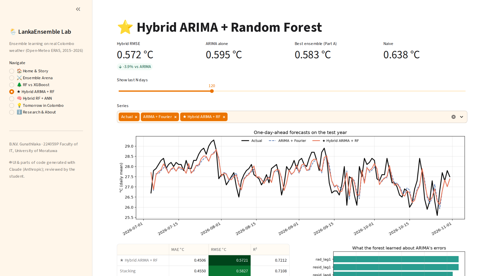
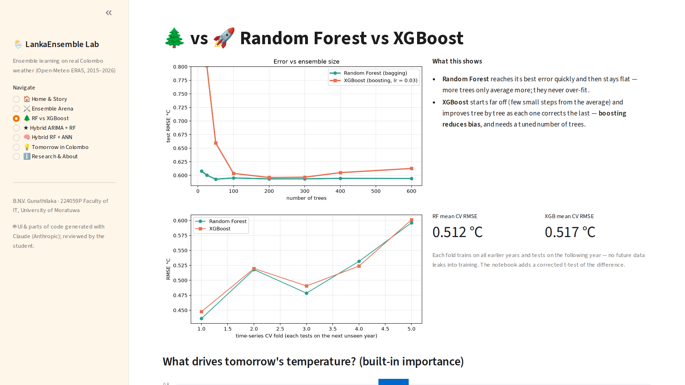
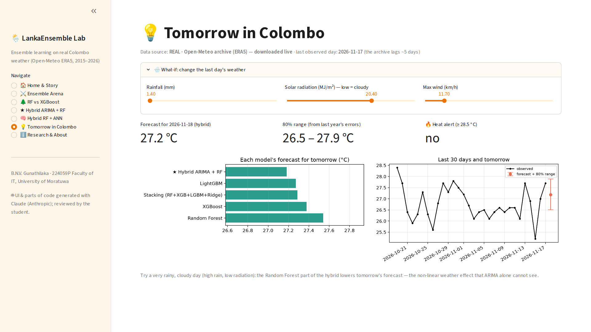

# 🌦️ LankaEnsemble Lab — Forecasting Colombo's Weather with Ensemble Learning

**B.N.V. Gunathilaka · 224059P · Faculty of IT, University of Moratuwa**
Hands-on Project (10%) — Ensemble Learning Dashboard

* 📓 **Executed notebook:** [`LankaEnsemble_Lab.ipynb`](LankaEnsemble_Lab.ipynb) · [Open in Colab](https://colab.research.google.com/github/navo1212/lanka-ensemble-lab/blob/main/LankaEnsemble_Lab.ipynb)
* 📊 **Live dashboard: https://lanka-ensemble-lab.streamlit.app** — if the app was asleep, the first page needs about a minute to train the models

**One real Sri Lankan dataset:** daily weather for Colombo, 1 Jan 2015 – 31 Oct 2026, from the free Open-Meteo historical archive (ERA5 reanalysis) — mean/max/min temperature, rainfall, wind and solar radiation (`data/colombo_weather_daily_used.csv`).
**Task:** forecast **tomorrow's mean temperature** using only information up to today. Test set: the last 365 days.

| Part | What | Ensemble idea |
|---|---|---|
| A | Ensemble Arena — 13 models | **Bagging** (Bagging, Random Forest, Extra Trees) · **Boosting** (AdaBoost, Gradient Boosting, XGBoost, LightGBM, CatBoost) · **Stacking** & voting |
| B | Random Forest vs XGBoost | Time-series cross-validation + corrected t-test, error vs number of trees, feature importance |
| C | ⭐ Hybrid **ARIMA + Random Forest** | ARIMA models the linear/seasonal part, the forest learns ARIMA's errors from rain, wind and radiation |
| D | Hybrid **Random Forest + neural network** | Weighted blend, residual hybrid, stacking |
| 💡 | Innovation | Errors by monsoon season · "Tomorrow in Colombo": live forecast, 80% range, heat alert and a rain what-if |

## Dashboard screenshots
| Ensemble Arena | Hybrid ARIMA + RF |
|---|---|
|  |  |
| **RF vs XGBoost** | **💡 Tomorrow in Colombo** |
|  |  |

## Repository layout
```
LankaEnsemble_Lab.ipynb            executed notebook (all outputs) — the submission notebook
notebook_src.py                    notebook source in "percent" format (cells separated by # %%)
build_notebook.py                  turns notebook_src.py into the .ipynb
app.py                             Streamlit dashboard
requirements.txt                   dashboard dependencies
data/colombo_weather_daily_used.csv  the real Colombo weather data (Open-Meteo / ERA5)
results_summary.json               headline results written by the notebook
.github/workflows/run-notebook.yml GitHub Actions: build and execute the notebook, commit the outputs
.github/workflows/screenshots.yml  GitHub Actions: run the dashboard and screenshot every page
tools/screenshot_dashboard.py      the screenshot script
```

## Run it yourself
* **Notebook:** click *Open in Colab* → *Runtime → Run all* (≈ 5 min). If the CSV is missing it downloads the data from Open-Meteo itself.
* **Dashboard:** `pip install -r requirements.txt` then `streamlit run app.py`.

## Generative AI declaration
Parts of the code in the notebook and the Streamlit dashboard UI were **generated with the help of Claude (Anthropic)**. I reviewed, ran and tested the code, and the analysis choices, interpretation and conclusions are my own responsibility.

## References
Breiman (1996, 2001) · Freund & Schapire (1997) · Friedman (2001) · Chen & Guestrin (2016) XGBoost · Ke et al. (2017) LightGBM · Prokhorenkova et al. (2018) CatBoost · Wolpert (1992) Stacked generalization · Zhang (2003) Hybrid ARIMA–NN · Nadeau & Bengio (2003) · Open-Meteo Historical Weather API.
