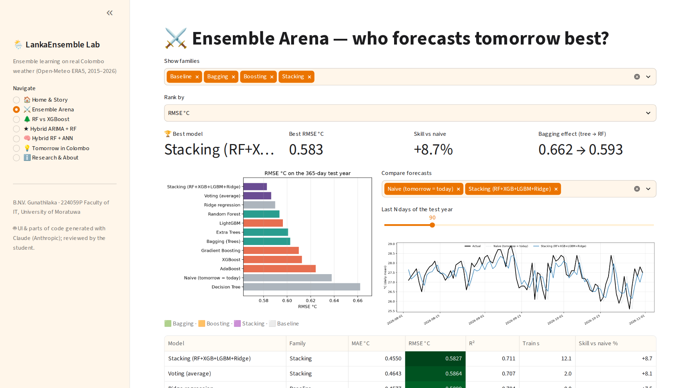
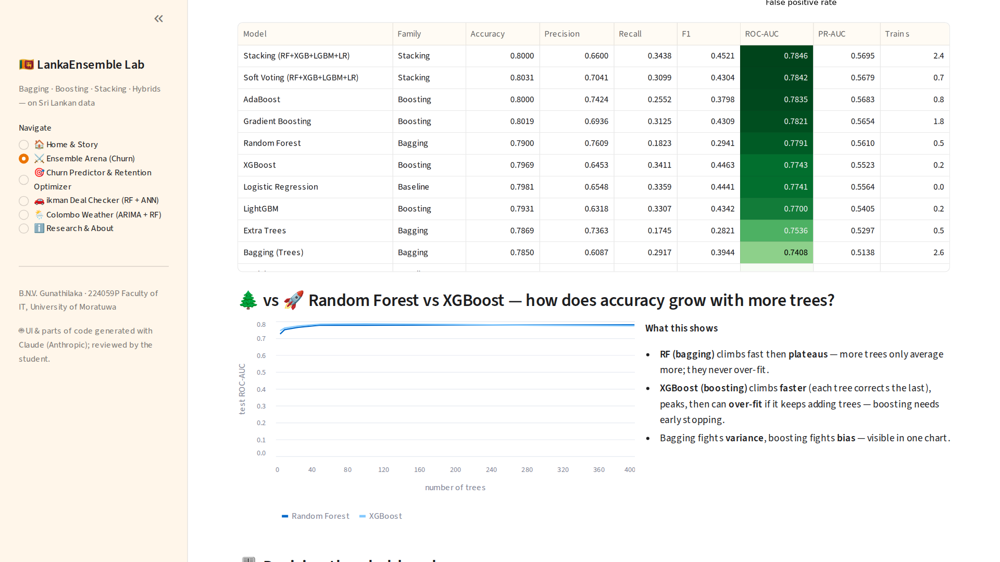
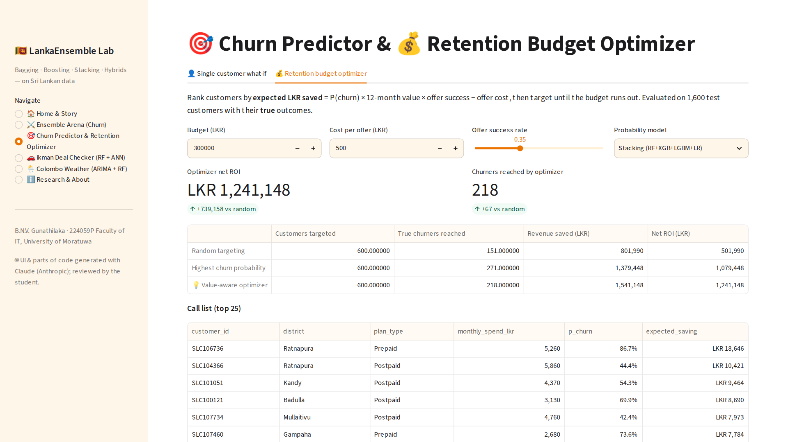
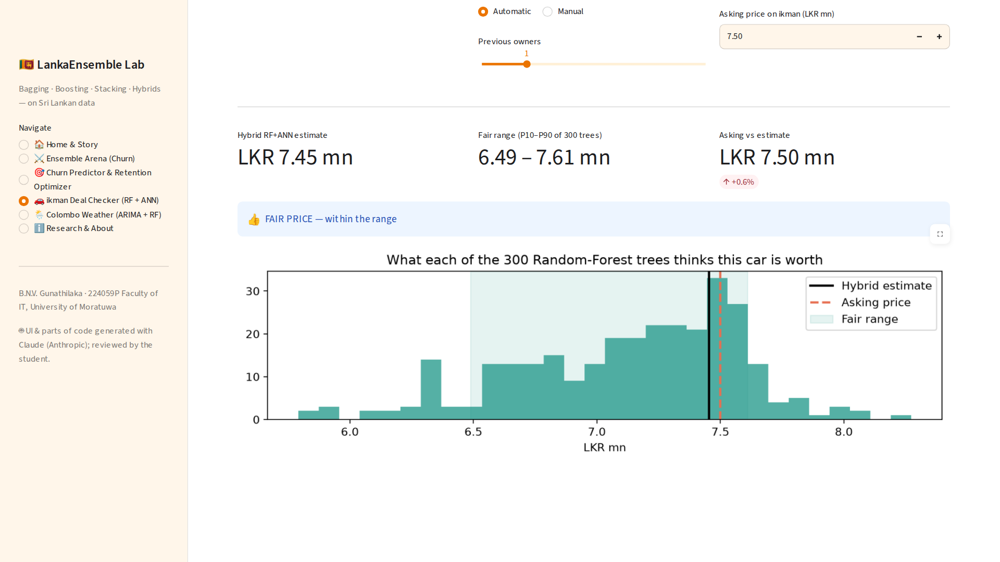
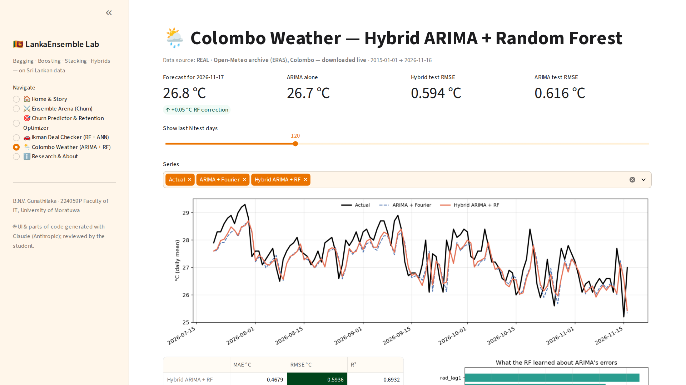
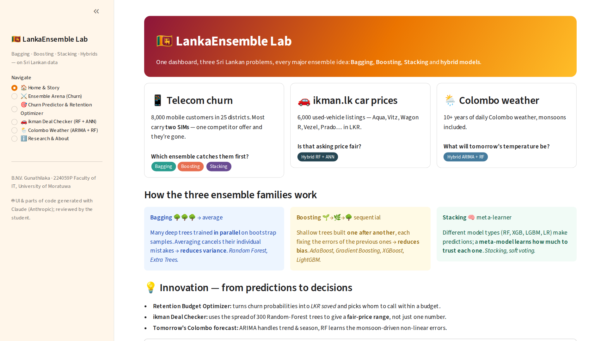

# 🇱🇰 LankaEnsemble Lab — Ensemble Learning Dashboard on Sri Lankan Data

**B.N.V. Gunathilaka · 224059P · Faculty of IT, University of Moratuwa**
Hands-on Project (10%) — Ensemble Learning Dashboard

* 📓 **Executed notebook:** [`LankaEnsemble_Lab.ipynb`](LankaEnsemble_Lab.ipynb) · [Open in Colab](https://colab.research.google.com/github/navo1212/lanka-ensemble-lab/blob/main/LankaEnsemble_Lab.ipynb)
* 📊 **Live dashboard: https://lanka-ensemble-lab.streamlit.app** — if the app was asleep, the first page needs ~1 minute to train the models (screenshots below were taken automatically by GitHub Actions, `.github/workflows/screenshots.yml`)

One dashboard, three Sri Lankan problems, every major ensemble idea:

| Part | Problem | Data | Ensemble technique |
|---|---|---|---|
| A | Mobile customer churn | 8,000 customers, 25 districts (synthetic, Sri Lankan context) | **Bagging** (Bagging, RF, Extra Trees) · **Boosting** (AdaBoost, GBM, XGBoost, LightGBM, CatBoost) · **Stacking** & soft voting |
| B | RF vs XGBoost | same | 5×3 repeated CV + Nadeau–Bengio corrected t-test, ensemble-size curves, permutation importance |
| C | ikman.lk-style used-car prices (LKR) | 6,000 listings (synthetic, Sri Lankan context) | **Hybrid RF + ANN**: weighted blend, residual hybrid, stacking |
| D | Colombo daily temperature | **Real** Open-Meteo (ERA5) daily data, 2015 → 2026 | **Hybrid ARIMA + RF** (Zhang 2003 residual hybrid) |
| 💡 | Innovation | — | **Retention Budget Optimizer** (LKR) · **ikman Deal Checker** with RF fair-price range · next-day Colombo forecast |

## Dashboard screenshots
| Ensemble Arena (bagging · boosting · stacking) | RF vs XGBoost: accuracy vs number of trees |
|---|---|
|  |  |
| **💡 Retention Budget Optimizer (LKR)** | **💡 ikman Deal Checker (hybrid RF + ANN)** |
|  |  |
| **Colombo weather (hybrid ARIMA + RF, real data)** | **Home** |
|  |  |

## Repository layout
```
LankaEnsemble_Lab.ipynb            executed notebook (all outputs) — the submission notebook
notebook_src.py                    notebook source in "percent" format (cells separated by # %%)
build_notebook.py                  turns notebook_src.py into the .ipynb
app.py                             Streamlit dashboard
requirements.txt                   dashboard dependencies
data/generate_datasets.py          seeded generators for the Sri Lankan-context datasets
data/*.csv                         generated datasets + the real Colombo weather used
results_summary.json               headline results written by the notebook
.github/workflows/run-notebook.yml GitHub Actions: generate data → build → execute notebook → commit
.streamlit/config.toml             dashboard theme
```
Every push that changes the notebook source makes **GitHub Actions** regenerate the data, rebuild the notebook and execute it end-to-end with real XGBoost, LightGBM, CatBoost and statsmodels, then commit the executed notebook back to the repository.

## Run it yourself
* **Notebook:** click *Open in Colab* above → *Runtime → Run all* (≈ 5 min). No uploads needed: it generates the datasets and downloads the real Colombo weather itself.
* **Dashboard:** `pip install -r requirements.txt` then `streamlit run app.py`.

## Data honesty statement
* **Colombo weather** is **real** daily data from the Open-Meteo historical archive (ERA5 reanalysis) for Colombo (6.93°N, 79.86°E). If the internet is unavailable, a synthetic fallback with the same columns is used and this is shown.
* **Telecom churn** and **vehicle prices** are **synthetic Sri Lankan-context datasets** generated by me (`data/generate_datasets.py`, fixed seed). Real operator customer data is confidential and mass-scraping ikman.lk breaches its terms of use. The generators encode Sri Lankan patterns: district populations and provinces, Tamil/Sinhala language areas, weaker rural/North-East network quality, dual-SIM behaviour, competitor offers, eZ Cash / reload-card payments, fibre/TV bundles; common local car models (Aqua, Vitz, Wagon R, Vezel, Prado…), recondition vs registered, the 2015–2019 import-ban scarcity premium and old-hybrid battery risk. The pipeline works unchanged on a real CSV with the same columns.

## Generative AI declaration
Parts of the code in the notebook and the Streamlit dashboard UI were **generated with the help of Claude (Anthropic)**. I reviewed, ran and tested the code, and the analysis choices, interpretation and conclusions are my own responsibility.

## References
Breiman (1996, 2001) · Freund & Schapire (1997) · Friedman (2001) · Chen & Guestrin (2016) XGBoost · Ke et al. (2017) LightGBM · Prokhorenkova et al. (2018) CatBoost · Wolpert (1992) Stacked generalization · Zhang (2003) Hybrid ARIMA–NN · Nadeau & Bengio (2003) · Open-Meteo Historical Weather API.
